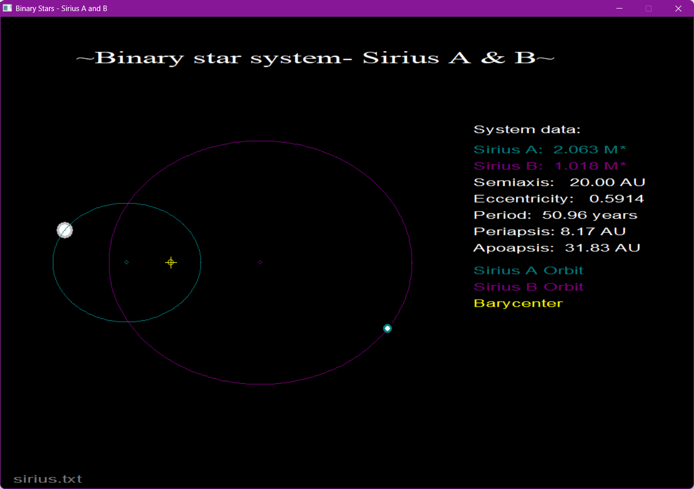

# Sirius Binary Star Simulation

A small graphics 2D simulation of the Sirius binary star system, with its stars Sirius A and Sirius B, written in C/C++ with the WinBGIm graphics library (`graphics.h`). Both stars move along elliptical orbits around their barycenter, and their speed changes along the orbit as it does in real Keplerian motion: fast near periapsis, slow near apoapsis.

## Screenshot




The two orbits (Sirius A in cyan, Sirius B in magenta) and the barycenter (yellow cross), can be observed in the picture from above. Both stars  are moving on their orbits, always on opposite sides of the barycenter.A data panel with the masses, semi-major axis, eccentricity, orbital period, periapsis and apoapsis are also visible in the right plane of the window.

## Controls

- `SPACE`: pause / resume
- `ESC`: quit

## Input data

The program reads `sirius.txt` from the folder it is run in. The file contains four numbers separated by whitespace, in this order:

```
2.063
1.018
20.0
0.5914
```

1. mass of Sirius A (solar masses)
2. mass of Sirius B (solar masses)
3. semi-major axis of the relative orbit (AU)
4. eccentricity (0 <= e < 1)

If the file is missing or the values are invalid, the program uses the default values above, which are approximately those of the real Sirius system, and says so at the bottom of the window.

## Requirements and building

- Windows with a MinGW-based compiler (for example Code::Blocks or Dev-C++) and the WinBGIm library installed
- `conio.h` and `graphics.h` are used, so the program is Windows-specific

Typical build command with MinGW (adjust to your setup):

```
g++ sirius.cpp -o sirius -lbgi -lgdi32 -lcomdlg32 -luuid -loleaut32 -lole32
```

## The physics

- **Orbit sizes.** With the relative semi-major axis `a`, each star orbits the barycenter with semi-major axes `a1 = a*m2/(m1+m2)` (Sirius A) and `a2 = a*m1/(m1+m2)` (Sirius B). The more massive star moves on the smaller orbit.
- **Ellipse shape.** Each orbit is an ellipse with semi-minor axis `b = a_i*sqrt(1 - e^2)`. The barycenter is at a focus, so the ellipse center is shifted by `a_i*e` from it.
- **Position.** A star is placed with the parametric equations `x = cx + rx*cos(theta)` and `y = cy + ry*sin(theta)`. Sirius B uses `theta + pi`, which keeps the two stars opposite each other.
- **Period.** Kepler's third law, `T^2 = a^3/(m1+m2)`, with `T` in years, `a` in AU and masses in solar masses.
- **Speed.** Here `theta` is the eccentric anomaly `E`. From Kepler's equation `M = E - e*sin(E)` with `M = n*t`, we get `dE/dt = n/(1 - e*cos(E))`. Because the distance from the focus is `r = a1*(1 - e*cos(E))`, this is `dE/dt = n*a1/r`, so the angle step per frame is proportional to `1/r`.

## Notes

- Scale: 1 AU is drawn as 18 pixels. The star sizes are not to scale.
- Stars are erased and redrawn every frame, and the orbits and barycenter are redrawn on top.

## Author

Nicole-Klarisza Demjen
